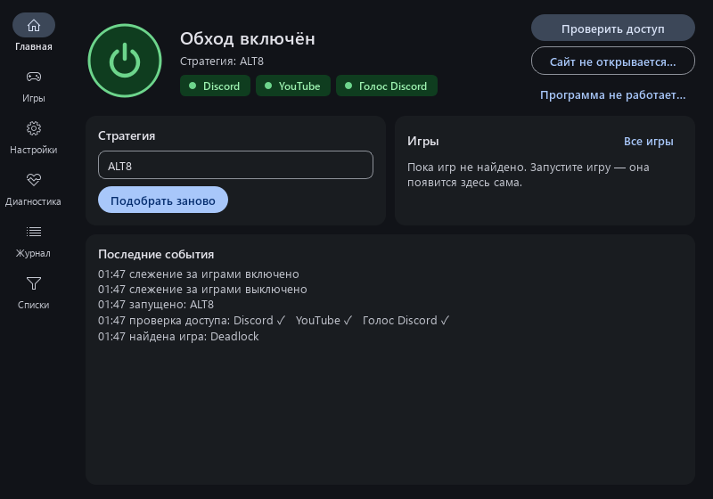

<p align="center"></p>

# ZapretAuto

[](https://github.com/yuav2/ZapretAuto/actions/workflows/tests.yml)
[](https://github.com/yuav2/ZapretAuto/releases/latest)

Программа, которая сама включает и чинит обход блокировок Discord, YouTube и онлайн-игр. Внутри — движок
[zapret](https://github.com/bol-van/zapret) (winws + WinDivert) и стратегии
[Flowseal/zapret-discord-youtube](https://github.com/Flowseal/zapret-discord-youtube). ZapretAuto сам подбирает
лучшую стратегию под вашего провайдера, следит, чтобы всё работало, и обновляется.

Windows 10/11 x64, нужны права администратора (драйвер WinDivert).

<p align="center"></p>

**Документация:** [Установка по шагам](docs/install.md) · [История изменений](CHANGELOG.md) · [Руководство](docs/guide.md) ·
[Решение проблем](docs/troubleshooting.md) · [Приватность](docs/privacy.md) · [Как это устроено](docs/how-it-works.md)

## Установка

Коротко (подробно, с картинками — [docs/install.md](docs/install.md)):

0. Удалите другие программы обхода (GoodbyeDPI, другой zapret) — они конфликтуют.
1. Скачайте `ZapretAuto-Setup.exe` со страницы [Releases](https://github.com/yuav2/ZapretAuto/releases/latest).
2. Запустите. Если Windows покажет «Windows защитила ваш компьютер» — «Подробнее» → «Выполнить в любом случае»
   (установщик пока не подписан). Галочка «Добавить папку в исключения Защитника» — рекомендуется.
3. При первом запуске нажмите «Начать»: подбор стратегии займёт 2–4 минуты. Если для вашего провайдера
   уже есть проверенная комбинация в общей базе — около 30 секунд.

Дальше программа живёт в трее. Большая кнопка в окне включает и выключает обход.

## Что умеет

**Подбор стратегий**
- Проверяет сайты с TLS-отпечатком Chrome — так же, как их открывают браузеры и Discord.
- Проверяет все стратегии Flowseal на Discord, YouTube (включая скорость загрузки), голосовой чат Discord
  и выбирает лучшую.
- Собирает **комбинацию**: для каждой группы сайтов берёт профиль из той стратегии, которая справляется с ней лучше.
- **Общая база по провайдерам**: если пользователи вашего провайдера уже нашли рабочую комбинацию,
  она проверяется первой. После подбора можно поделиться результатом (отправляется только номер сети
  провайдера, без IP).

**Работает сама**
- Каждые 10 минут и при смене сети проверяет доступ. Если Discord или YouTube перестали открываться —
  сама подбирает стратегию заново (не чаще раза в 6 часов и никогда посреди игры).
- Перезапускает winws, если он упал, и после выхода компьютера из сна.
- Сама находит сайты, которые режет DPI, и включает обход для них.
- Обновляет zapret, свои списки IP и саму себя (установщик проверяется по SHA-256).
- Тихо стартует в трей вместе с Windows.

**Игры**
- Не трогает серверы входа игр и лаунчеров (80/443 на CloudFront/Cloudflare) — вход не зависает.
- Находит запущенные игры (Steam, Epic, Riot, Battle.net и любые программы с игровым UDP-трафиком),
  собирает их серверы и включает для них обход.
- Если с обходом соединение с сервером стало хуже — убирает этот адрес сам.
- Игру можно добавить вручную, выбрав её exe.
- **Общая база серверов игр**: адресами найденных игр можно поделиться, и у других игра заработает
  с первого запуска. В базу попадают только адреса, которые прислали хотя бы двое.

**zapret2 (эксперимент)**
- Новый движок от автора zapret. Если сайт начинает блокироваться, обход сам переключает для него другую
  стратегию — без перезапуска и без подбора. Включается в «Дополнительно».

**Удобства**
- «Проверить доступ» — Discord, YouTube и голосовой чат ✓/✗ за пару секунд.
- «Сайт не открывается…» — проверит сайт, добавит в обход и скажет, помогло ли.
  Если сайт заблокирован по IP, честно скажет, что нужен VPN.
- Диагностика с кнопками «Исправить»: конфликтующие программы, зависший WinDivert, TCP timestamps, подмена DNS
  (включит защищённый DNS в браузерах), QUIC, который режет провайдер, кэш Discord и др.
- «Сохранить отчёт об ошибке» — zip с журналом и диагностикой (имя пользователя Windows скрыто).
- Статистика: сколько работал обход, сколько раз программа чинила его сама.

## VPN

ZapretAuto и VPN можно использовать вместе:
- серверы VPN автоматически исключаются из обхода, поэтому туннель не ломается;
- подбор и проверки идут мимо VPN, через обычный сетевой адаптер.

Лучше всего настроить в VPN **раздельное туннелирование**: через VPN — только то, что заблокировано
по IP (например, Telegram), остальное — напрямую через ZapretAuto.

## Защитник Windows и антивирусы

winws.exe и драйвер WinDivert перехватывают сетевые пакеты, поэтому антивирусы иногда помечают их
как «потенциально нежелательные» (riskware). Это ложное срабатывание — те же файлы входят в
оригинальный zapret. Если антивирус их удаляет, добавьте папку `C:\Program Files\ZapretAuto` в исключения
(в установщике есть галочка для Защитника Windows).

## Частые вопросы

**Ничего не открывается после установки.** Откройте раздел «Диагностика» → «Найти проблемы».
Чаще всего мешает другая программа обхода (GoodbyeDPI, другая копия zapret) или антивирус.

**YouTube в браузере тормозит, а «Проверить доступ» показывает ✓.** Диагностика → «QUIC в браузерах» → «Исправить»,
затем перезапустите браузер.

**Telegram.** Обход zapret помогает Telegram не у всех провайдеров. Надёжнее пустить Telegram через VPN.

**Что-то сломалось.** Диагностика → «Сохранить отчёт об ошибке» и создайте
[issue](https://github.com/yuav2/ZapretAuto/issues) с этим файлом.

## Для разработчиков

```
python -m venv .venv
.venv\Scripts\pip install -r requirements.txt
.venv\Scripts\python main.py                 # запуск из исходников (от администратора)
.venv\Scripts\python -m pytest -q            # тесты (офлайн)
powershell -File build.ps1                   # тесты + exe + установщик (нужен Inno Setup 6)
```

Устройство кода — в [CLAUDE.md](CLAUDE.md). Данные пользователя хранятся в `data\` рядом с exe
(или в `%PROGRAMDATA%\ZapretAuto\data`, если папка программы недоступна для записи).

## Благодарности

- [bol-van/zapret](https://github.com/bol-van/zapret) — движок обхода DPI
- [Flowseal/zapret-discord-youtube](https://github.com/Flowseal/zapret-discord-youtube) — стратегии и списки
- [WinDivert](https://github.com/basil00/WinDivert) — перехват пакетов в Windows

## In English

ZapretAuto is a Windows tray app that keeps Discord, YouTube and online games working through Russian DPI
blocking. It wraps [zapret](https://github.com/bol-van/zapret) (winws + WinDivert) and the
[Flowseal](https://github.com/Flowseal/zapret-discord-youtube) strategy pack and automates everything around them:

- **Auto-pick**: tests all strategies with a Chrome TLS fingerprint against Discord/YouTube/voice targets,
  mixes the best profile per target group, re-tests finalists and only replaces a working strategy when clearly beaten.
- **Self-healing**: background access checks, automatic re-pick on failures (never mid-game), winws crash restart,
  sleep/resume handling, auto-learned blocked domains (`--hostlist-auto`).
- **Games**: detects running games (incl. Steam networking/UDP via WinDivert flow capture), bypasses their match
  servers, per-game strategy profiles found by launching the game and counting servers that actually answered.
- **Updates**: zapret and the app itself update from GitHub releases (SHA-256 verified); releases are built and
  self-tested by GitHub Actions.
- **Shared ISP database**: proven picks per ASN, crowd-sourced through issues and merged by a GitHub Action.

The UI is Russian. Install: download `ZapretAuto-Setup.exe` from [Releases](https://github.com/yuav2/ZapretAuto/releases/latest).
