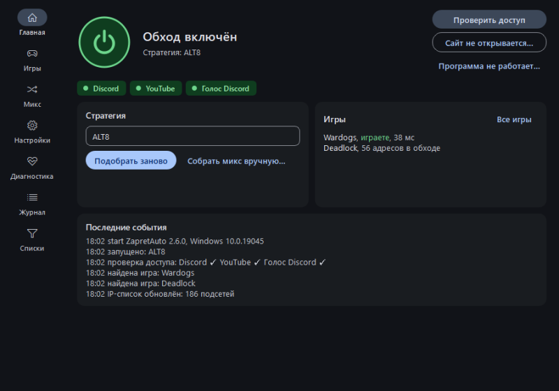

<p align="center"></p>

# ZapretAuto

[](https://github.com/Deuus20/ZapretAuto/actions/workflows/tests.yml)
[](https://github.com/Deuus20/ZapretAuto/releases/latest)

ZapretAuto это программа для Windows, которая сама настраивает и поддерживает обход блокировок Discord, YouTube
и онлайн-игр. Внутри работают движок [zapret](https://github.com/bol-van/zapret) (winws + WinDivert) и стратегии
[Flowseal/zapret-discord-youtube](https://github.com/Flowseal/zapret-discord-youtube). Программа подбирает
стратегию под вашего провайдера, следит за доступом к сайтам и обновляется сама.

Стратегии можно смешивать: для каждой группы целей (Discord, YouTube, голос, игры) программа выбирает лучший
профиль и собирает из них одну команду winws. Адреса игровых серверов она записывает сама: следит за запущенными
играми, перехватывает их трафик через WinDivert и складывает IP серверов в `data/lists/ipset-games.txt`, а этот
список подставляется в игровой фильтр. Поэтому обход работает не только в браузере, но и в матчах, лобби и
голосовых чатах.

Нужны Windows 10/11 x64 и права администратора: драйвер WinDivert работает только с ними.

<p align="center"></p>

**Документация:** [Установка по шагам](docs/install.md) · [История изменений](CHANGELOG.md) · [Руководство](docs/guide.md) ·
[Решение проблем](docs/troubleshooting.md) · [Приватность](docs/privacy.md) · [Как это устроено](docs/how-it-works.md)

## Установка

Коротко (подробно, с картинками: [docs/install.md](docs/install.md)):

0. Удалите другие программы обхода (GoodbyeDPI, другой zapret): они конфликтуют между собой.
1. Скачайте `ZapretAuto-Setup.exe` со страницы [Releases](https://github.com/Deuus20/ZapretAuto/releases/latest).
2. Запустите файл. Если Windows покажет «Windows защитила ваш компьютер», нажмите «Подробнее» и «Выполнить
   в любом случае»: установщик пока не подписан. Галочку «Добавить папку в исключения Защитника» лучше оставить.
3. При первом запуске нажмите «Начать». Подбор стратегии займёт 2-4 минуты. Если для вашего провайдера уже есть
   проверенная комбинация в общей базе, хватит около 30 секунд.

Дальше программа работает в трее. Большая кнопка в окне включает и выключает обход.

## Что умеет

**Подбор стратегий**
- Проверяет сайты с TLS-отпечатком Chrome, то есть так же, как их открывают браузеры и Discord.
- Проверяет все стратегии Flowseal на Discord, YouTube (включая скорость и сервер, с которого идёт видео),
  голосовой чат Discord и выбирает лучшую. После подбора показывает итог: «26 из 28 проверок (было 18)».
- Собирает **комбинацию**: для каждой группы сайтов берёт профиль из той стратегии, которая справляется с ней лучше.
- **Общая база по провайдерам**: если пользователи вашего провайдера уже нашли рабочую комбинацию, программа
  проверит её первой. После подбора можно поделиться результатом. Отправляется только номер сети провайдера, без IP.

**Работает сама**
- Каждые 10 минут и при смене сети проверяет доступ. Если Discord или YouTube перестали открываться, программа
  сама подбирает стратегию заново. Не чаще раза в 6 часов и никогда посреди игры.
- Раз в час проверяет скорость YouTube коротким запросом: если сайт открывается, а видео начало тормозить,
  запускает автоподбор.
- Отдельно проверяет Telegram: плашки «Telegram (веб)» (веб-клиент) и «Telegram (приложение)» (дата-центры).
  Если провайдер блокирует дата-центры по IP, программа честно говорит, что обход не поможет, и советует прокси или VPN.
- Отличает белые списки провайдера от обычной блокировки: когда открываются только разрешённые сайты, советует
  VPN или другую сеть, а не крутит подбор заново.
- Если подбор не помог и белых списков нет, один раз предлагает перейти на zapret2 (он сам переключает стратегии
  для каждого сайта), а если и тот не справился, возвращает обычный обход.
- Перезапускает winws, если он упал, и после выхода компьютера из сна.
- Сама находит сайты, которые режет DPI, и включает для них обход.
- Обновляет zapret, свои списки IP и саму себя. Установщик проверяется по SHA-256 и подписи.
- Тихо стартует в трей вместе с Windows.

**Игры**
- Не трогает серверы входа игр и лаунчеров (80/443 на CloudFront/Cloudflare), поэтому вход не зависает.
- Находит запущенные игры (Steam, Epic, Riot, Battle.net и любые программы с игровым UDP-трафиком), собирает
  их серверы и включает для них обход.
- Если с обходом соединение с сервером стало хуже, убирает этот адрес сам.
- Игру можно добавить вручную, выбрав её exe. Порты обхода для игр настраиваются: порт трансляций OBS обход не трогает.
- Любую игру можно оставить вне обхода, не убирая из списка. Для этого есть галочка «Обход» в строке игры,
  пункт в меню трея или общий переключатель «Перехватывать подключения игр».
- **Общая база серверов игр**: адресами найденных игр можно поделиться, и у других игра заработает с первого
  запуска. В базу попадают только адреса, которые прислали хотя бы двое.

**zapret2 (эксперимент)**
- Новый движок от автора zapret. Если сайт начинает блокироваться, обход сам переключает для него другую
  стратегию, без перезапуска и без подбора. Включается в «Дополнительно». Если обычный подбор бессилен,
  программа предлагает этот режим сама и умеет вернуться назад.

**DNS**
- В «Дополнительно» можно вернуть DNS провайдера, выбрать популярный (Cloudflare, Google, Quad9, AdGuard, Яндекс) или свой, либо доверить автоподбору: программа проверит ответы, сравнив их с DoH, измерит скорость и поставит лучший.
- Если провайдер подменяет DNS, подбор стратегии не запускается: на таких ответах он выбрал бы случайную стратегию. Можно починить DNS в один клик (резолвер, DoH в браузерах, адреса в hosts) или подобрать всё равно.

**Удобства**
- Тёмная и светлая тема, как в Windows. Переключается на лету.
- «Проверить доступ»: Discord, YouTube, голосовой чат и Telegram с отметками ✓/✗ за пару секунд.
- «Сайт не открывается…»: проверит сайт и попробует оба пути. Либо включит для него обход, либо, если сайт
  ломается из-за обхода, исключит его. Если сайт заблокирован по IP, честно скажет, что нужен VPN.
- «Программа не работает…»: если Spotify, лаунчер или мод игры не работает с обходом, укажите exe, и обход
  перестанет трогать её серверы.
- Диагностика с кнопками «Исправить»: конфликтующие программы, зависший WinDivert, TCP timestamps, подмена DNS
  (включает защищённый DNS в браузерах), QUIC, который режет провайдер, кэш Discord и другое.
- «Отправить отчёт разработчику»: готовый отчёт на GitHub в один клик, имя пользователя и IP скрыты.
  «Сохранить в zip»: полный журнал и диагностика отдельным файлом.
- Статистика: сколько работал обход и сколько раз программа чинила его сама.

## VPN

ZapretAuto и VPN можно использовать вместе:
- серверы VPN автоматически исключаются из обхода, поэтому туннель не ломается;
- подбор и проверки идут мимо VPN, через обычный сетевой адаптер.

Лучше всего настроить в VPN **раздельное туннелирование**: через VPN пусть идёт только то, что заблокировано
по IP (например, Telegram), а остальное идёт напрямую через ZapretAuto.

## Защитник Windows и антивирусы

winws.exe и драйвер WinDivert перехватывают сетевые пакеты, поэтому антивирусы иногда помечают их как
«потенциально нежелательные» (riskware). Это ложное срабатывание: те же файлы входят в оригинальный zapret.
Если антивирус их удаляет, добавьте папку `C:\Program Files\ZapretAuto` в исключения. В установщике есть
галочка для Защитника Windows.

## Частые вопросы

**Ничего не открывается после установки.** Откройте раздел «Диагностика» и нажмите «Найти проблемы».
Чаще всего мешает другая программа обхода (GoodbyeDPI, другая копия zapret) или антивирус.

**YouTube в браузере тормозит, а «Проверить доступ» показывает ✓.** Откройте «Диагностика», найдите
«QUIC в браузерах», нажмите «Исправить» и перезапустите браузер.

**Провайдер подменяет DNS.** Откройте «Настройки» → «Дополнительно» → «DNS» и выберите «Авто»: программа
проверит резолверы и поставит рабочий. Затем «Диагностика» → «Подмена DNS» → «Исправить»: это включит DoH в
браузерах и запишет адреса Discord, YouTube, Telegram и GitHub в hosts.

**Telegram.** Веб-версия и приложение ходят в разные места, поэтому в проверке две плашки. «Telegram (веб)» - это
веб-клиент, «Telegram (приложение)» - серверы, к которым подключается программа. Если провайдер блокирует
дата-центры по IP, веб может открываться, а приложение будет висеть на «Подключение»: «Telegram (веб)» ✓,
«Telegram (приложение)» ✗. Программа в этом случае объяснит причину: нужен VPN или прокси, стратегии обхода тут
бессильны. Надёжнее пустить Telegram через VPN.

**Что-то сломалось.** Откройте «Диагностика» и нажмите «Отправить отчёт разработчику». Откроется готовое
[issue](https://github.com/Deuus20/ZapretAuto/issues), останется нажать «Create».

Об уязвимостях пишите не в issue, а по инструкции из [SECURITY.md](SECURITY.md): это приватный отчёт, чтобы
детали не увидели раньше исправления.

## Для разработчиков

```
python -m venv .venv
.venv\Scripts\pip install -r requirements-dev.txt   # runtime-зависимости, сборка и проверки
.venv\Scripts\python main.py                 # запуск из исходников, от администратора
.venv\Scripts\python -m pytest -q            # тесты, работают офлайн
.venv\Scripts\ruff check main.py app scripts tools tests   # стиль и импорты
powershell -File build.ps1                   # тесты, exe и установщик (нужен Inno Setup 6)
```

Устройство кода описано в [AGENTS.md](AGENTS.md). Данные пользователя хранятся в `data\` рядом с exe,
либо в `%PROGRAMDATA%\ZapretAuto\data`, если папка программы недоступна для записи.

## Участие

Ошибки и идеи: [issues](https://github.com/Deuus20/ZapretAuto/issues). Как собрать проект и что проверить перед PR: [CONTRIBUTING.md](CONTRIBUTING.md). Правила общения: [CODE_OF_CONDUCT.md](CODE_OF_CONDUCT.md). Доступность и известные ограничения: [ACCESSIBILITY.md](ACCESSIBILITY.md).

## Лицензии

Код ZapretAuto распространяется по MIT, текст в [LICENSE](LICENSE). В состав входят сторонние компоненты: zapret и стратегии Flowseal (MIT), WinDivert (LGPLv3), Qt и PySide6 (LGPLv3), Cygwin (LGPLv3+ с исключением), Python (PSF-2.0), PyInstaller (GPLv2+ с исключением). Полные тексты, copyright и ссылки на исходники: [THIRD-PARTY-NOTICES.md](THIRD-PARTY-NOTICES.md) и папка `LICENSES`.

## Благодарности

- [bol-van/zapret](https://github.com/bol-van/zapret): движок обхода DPI
- [Flowseal/zapret-discord-youtube](https://github.com/Flowseal/zapret-discord-youtube): стратегии и списки
- [WinDivert](https://github.com/basil00/WinDivert): перехват пакетов в Windows

## In English

ZapretAuto is a Windows tray app that keeps Discord, YouTube and online games working through Russian DPI
blocking. It wraps [zapret](https://github.com/bol-van/zapret) (winws + WinDivert) and the
[Flowseal](https://github.com/Flowseal/zapret-discord-youtube) strategy pack, and automates everything around them:

- **Auto-pick**: tests all strategies with a Chrome TLS fingerprint against Discord, YouTube and voice targets,
  mixes the best profile per target group, re-tests finalists and replaces a working strategy only when clearly beaten.
- **Self-healing**: background access checks, automatic re-pick on failures (never mid-game), winws crash restart,
  sleep/resume handling, auto-learned blocked domains (`--hostlist-auto`).
- **Games**: detects running games (including Steam networking and UDP traffic via WinDivert flow capture),
  bypasses their match servers, and finds per-game strategies by launching the game and counting servers that answered.
- **Updates**: zapret and the app itself update from GitHub releases, with SHA-256 and a signed manifest checked before
  install. Releases are built and self-tested by GitHub Actions.
- **Shared ISP database**: proven picks per ASN, crowd-sourced through issues and merged by a GitHub Action.

The UI is Russian. Install: download `ZapretAuto-Setup.exe` from [Releases](https://github.com/Deuus20/ZapretAuto/releases/latest).

License: MIT, see [LICENSE](LICENSE). Third-party components and their licenses are listed in [THIRD-PARTY-NOTICES.md](THIRD-PARTY-NOTICES.md).
