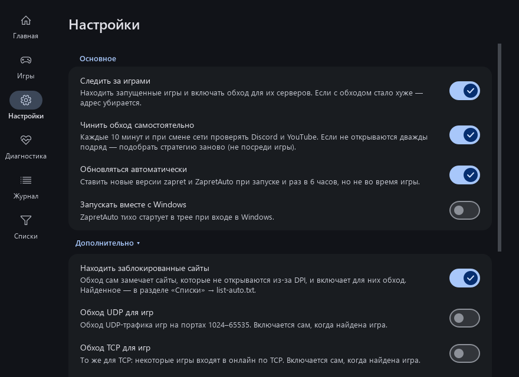
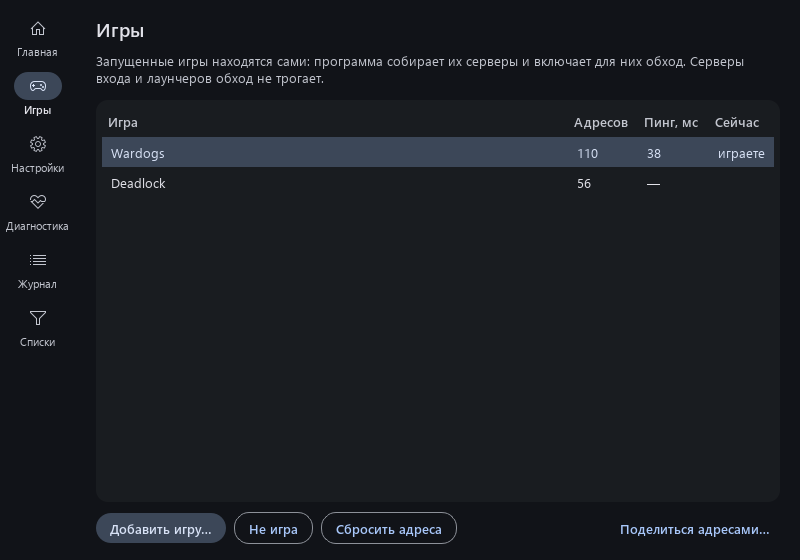
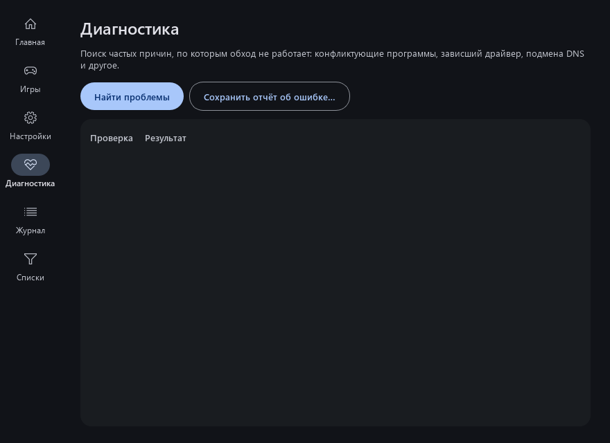
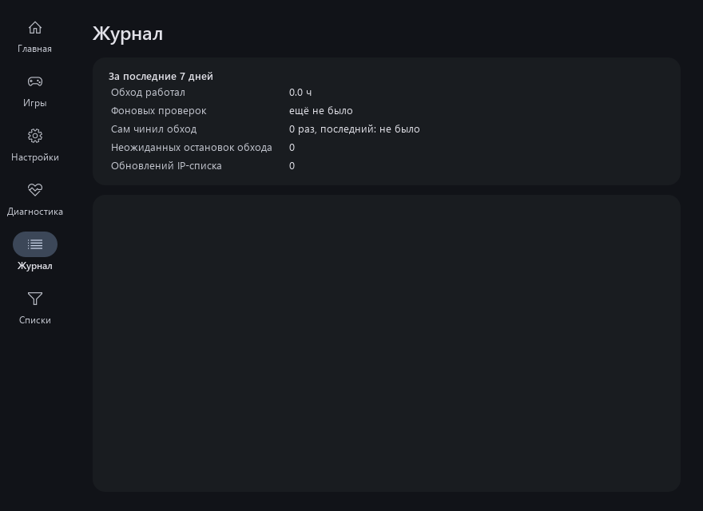

# Руководство пользователя

Слева — разделы программы: **Главная**, **Игры**, **Настройки**, **Диагностика**, **Журнал** и **Списки**
(виден, когда в настройках открыто «Дополнительно»). Переключаться можно и клавишами Ctrl+1 … Ctrl+6.

## Главная

| Элемент | Что делает |
|---|---|
| **Большая кнопка** | Включает и выключает обход. Кольцо: серое — выключен, зелёное — работает, янтарное с бегущей дугой — идёт подбор или обновление. |
| **Строка состояния** | Что сейчас происходит и какая стратегия выбрана. Красный текст — ошибка и что делать. |
| **Метки сервисов** | Результат последней проверки: зелёная — работает, красная с пометкой «нет» — не открывается (подробности при наведении). |
| **Проверить доступ** | За пару секунд проверяет Discord, YouTube, скорость YouTube и голосовой чат Discord. |
| **Сайт не открывается…** | Введите адрес сайта: программа проверит его, при необходимости добавит в обход и скажет, помогло ли. Если сайт заблокирован по IP-адресу — сообщит, что нужен VPN. |
| **Стратегия** | «Авто (результат подбора)» — то, что выбрал последний подбор. Можно выбрать любую стратегию вручную. |
| **Подобрать стратегию** | Заново подбирает стратегию (2–4 минуты). Во время подбора есть «Отменить подбор» — обход вернётся к прежней стратегии. |
| **Последние события** | Четыре последних записи журнала. |

Значок в трее (щит у часов) повторяет цвет кнопки. Наведите — увидите стратегию и время последней проверки.
Клик — открыть окно, правый клик — меню:

- **Включить / Выключить**;
- **Выключить на 15 минут** — если обход мешает какому-то сайту (например, банку); включится сам;
- **Проверить доступ** — результат придёт уведомлением;
- **Подобрать стратегию**, **Открыть**, **Выход**.

## Настройки

Каждая настройка — строка с переключателем. Наведите мышь на строку или переключатель — появится
описание, что она делает. Нажать можно на переключатель или на всю строку.

| Настройка | По умолчанию | Что делает |
|---|---|---|
| **Следить за играми** | выкл | Находит запущенные игры и включает обход для их серверов. См. [Игры](#игры). |
| **Чинить обход самостоятельно** | вкл | Каждые 10 минут и при смене сети проверяет доступ. Если Discord/YouTube дважды подряд не открываются — сам подбирает стратегию заново. Не чаще раза в 6 часов и никогда во время игры. |
| **Обновляться автоматически** | вкл | Обновляет zapret и саму программу при запуске и раз в 6 часов, но не во время игры. |
| **Запускать вместе с Windows** | выкл | Тихий старт в трей при входе в Windows (с правами администратора, без запроса UAC). |

**Дополнительно** (раскрывается по нажатию):

| Настройка | По умолчанию | Что делает |
|---|---|---|
| **Находить заблокированные сайты** | вкл | Обход замечает сайты, которые не открываются из-за DPI, и включает обход для них. Найденное — в разделе «Списки»; лишнее можно удалить. |
| **Обход UDP для игр** | выкл | Принудительно включает обход UDP-трафика игр (порты 1024–65535). При найденной игре включается сам вместе с TCP. |
| **Обход TCP для игр** | выкл | То же для TCP. При найденной игре включается сам — некоторые игры (например, Wardogs) входят в онлайн по TCP. |
| **Telegram (эксперимент)** | выкл | Добавляет подсети Telegram в обход. Помогает не всем провайдерам — надёжнее пустить Telegram через VPN. |
| **zapret2 (эксперимент)** | выкл | Новый движок zapret2 (winws2). Для каждого сайта он сам замечает блокировку (сброс соединения, повторные отправки) и переключает этот сайт на следующую из 5 стратегий — без перезапуска и без подбора. При первом включении скачивается ~4 МБ из официального набора автора zapret, каждый файл проверяется по контрольной сумме. Пока режим включён, выбор стратегии и подбор не нужны и недоступны. |

Внизу — **Обновления**: версии ZapretAuto и zapret, «Проверить обновления» (результат пишется ниже)
и «Обновить zapret».

## Игры

Список найденных игр: сколько адресов серверов собрано, пинг, запущена ли игра сейчас (обновляется на лету).

- **Добавить игру…** — указать exe игры вручную, если она не нашлась сама.
- **Не игра** — больше не считать выбранную программу игрой и убрать её адреса из обхода.
- **Сбросить адреса** — убрать собранные адреса выбранной игры (если после добавления ей стало хуже).
- **Поделиться адресами…** — отправить найденные серверы игр в общую базу (откроется страница GitHub,
  нужен аккаунт). Отправляются только адреса серверов игр, без вашего IP. Адрес попадает в базу, когда его
  прислали хотя бы двое разных людей; программа загружает базу при запуске
  ([`games-db.json`](../games-db.json)), и игра работает с первого запуска.

Серверы входа и сайты игр и их лаунчеров (порты 80/443: CloudFront, Cloudflare и т. п.) обход **не трогает**:
они попадают в широкие диапазоны общего IP-списка, и вмешательство в них вешало вход («Вход в систему…»).
Их адреса собираются сами в `data/lists/ipset-exclude-games.txt`.

Как это работает: программа видит, к каким серверам подключается игра (через WinDivert, без
вмешательства в трафик), и добавляет их в обход. Затем проверяет: если с обходом соединение стало хуже —
убирает адрес. Игры определяются по папкам Steam, Epic, Riot, Battle.net, Ubisoft, EA, GOG, Xbox, а также
любые программы, которые активно обмениваются UDP с несколькими серверами (кроме браузеров,
торрентов, мессенджеров, VPN).

Совет: запускайте игру после ZapretAuto. Если игра уже была запущена и не подключается —
перезапустите её после уведомления «Найдена игра».

## Диагностика

**Найти проблемы** проверяет частые причины неработающего обхода. Где можно — есть кнопка
**«Исправить»**:

| Проверка | Если не ок |
|---|---|
| Base Filtering Engine | Служба Windows, без которой WinDivert не работает. Должна быть запущена. |
| TCP timestamps | Рекомендуется включить — «Исправить». |
| Файлы обхода | winws.exe или файлы WinDivert удалил антивирус — добавьте папку в исключения и переустановите программу. |
| Конфликтующие службы | GoodbyeDPI, Killer Network, SmartByte и др. мешают обходу — удалите/отключите. |
| Служба zapret | Запущен другой zapret — «Исправить» остановит его. |
| AdGuard | Может ломать Discord — отключите фильтрацию трафика или добавьте Discord в исключения AdGuard. |
| Остаточный WinDivert | Драйвер завис без winws — «Исправить». |
| Secure DNS (DoH) | Провайдер может подменять DNS. Включите защищённый DNS в Windows или браузере. |
| Подмена DNS | Провайдер отдаёт фальшивые адреса или отвечает «такого сайта нет» для заблокированных сайтов — обход не поможет, пока не включён защищённый DNS (DoH). «Исправить» включит его в Chrome, Edge и Яндекс.Браузере. |
| VPN | Показывает, как VPN влияет на обход. |
| QUIC в браузерах | Программа пробует открыть YouTube по HTTP/3 (QUIC). Если не проходит (ТСПУ режет QUIC с 2026 года), видео в браузере стартует медленно — «Исправить» отключит QUIC в браузерах; перезапустите браузер. |
| Кэш Discord | Если Discord висит на загрузке или проверке обновлений — «Исправить» закроет Discord и очистит его кэш (вход сохраняется). |

**Отправить отчёт разработчику…** — не помогло? Откроется страница GitHub с готовым отчётом: версии,
найденные проблемы и конец журнала; нажмите «Create». Имя пользователя и IP-адреса скрыты. То же есть
в меню значка в трее, а после неудачного подбора программа предложит это сама.

**Сохранить в zip…** — полный журнал, диагностика и настройки одним файлом (можно приложить к отчёту).

## Журнал

Сверху — статистика за 7 дней: сколько работал обход, сколько было фоновых проверок и какой процент
успешных, сколько раз программа чинила обход сама. Ниже — что делала программа: запуски, проверки, подбор,
обновления. Полный журнал хранится в `C:\Program Files\ZapretAuto\data\logs\`.

## Списки

Виден, когда в настройках открыто «Дополнительно». Редактор своих списков:

- **Сайты, для которых включить обход** — по одному домену в строке;
- **Сайты, которые обход не трогает**;
- **IP-адреса, которые обход не трогает** — адреса или подсети;
- **Адреса игровых серверов (вручную)** — свои IP/подсети игровых серверов.

**Обновить IP-список с GitHub** — свежий список IP-диапазонов (обновляется и сам раз в неделю).

## Общая база провайдеров

У разных провайдеров разные блокировки, и лучшая стратегия у всех своя. Общая база хранит
проверенные комбинации по провайдерам (номерам сетей AS):

1. При подборе программа узнаёт номер сети вашего провайдера и смотрит базу.
2. Если есть комбинация — проверяет её у вас; если она проходит ≥85% проверок — подбор окончен за ~30 секунд.
3. После полного подбора можно поделиться результатом: откроется страница GitHub с готовым отчётом,
   нужно только нажать «Submit» (нужен аккаунт GitHub). Бот проверит отчёт и добавит его в базу;
   в базе побеждает комбинация, которую прислали больше людей.

База: [`strategies-db.json`](../strategies-db.json). Что именно отправляется — [Приватность](privacy.md).
