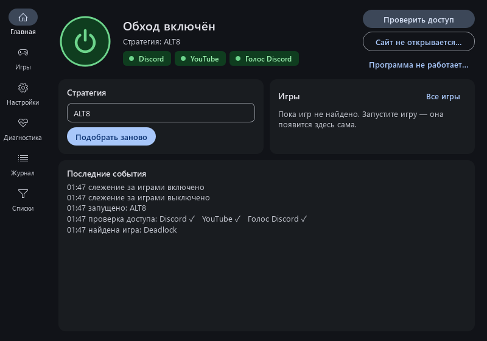
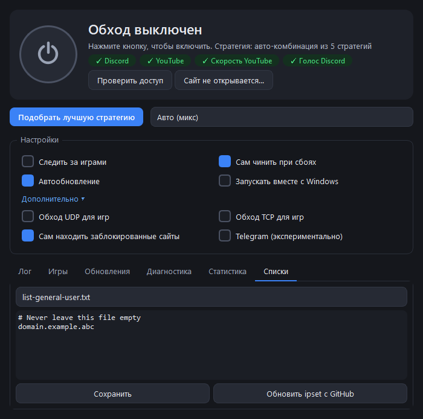
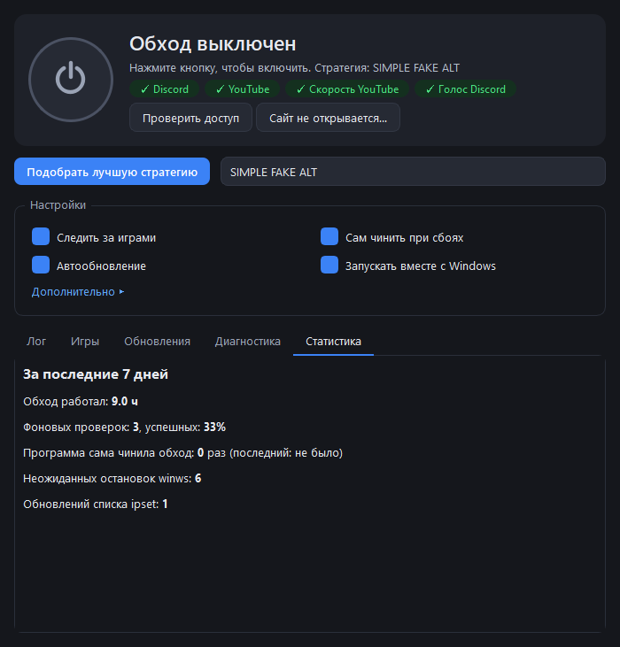

# Руководство пользователя

## Главное окно

| Элемент | Что делает |
|---|---|
| **Большая кнопка** | Включает и выключает обход. Цвет: серый — выключен, зелёный — работает, оранжевый — идёт подбор или обновление. |
| **Строка состояния** | Что сейчас происходит и какая стратегия выбрана. Красный текст — ошибка и что делать. |
| **Проверить доступ** | За пару секунд проверяет Discord, YouTube, скорость YouTube и голосовой чат Discord. Результат — цветные метки ✓/✗. |
| **Сайт не открывается…** | Введите адрес сайта: программа проверит его, при необходимости добавит в обход и скажет, помогло ли. Если сайт заблокирован по IP-адресу — сообщит, что нужен VPN. |
| **Подобрать лучшую стратегию** | Заново подбирает стратегию (2–4 минуты). Нужно, если что-то перестало работать, а программа ещё не починила сама. |
| **Список стратегий** | «Авто (микс)» — подобранная комбинация. Можно выбрать любую стратегию вручную. |

Значок в трее (щит у часов) повторяет цвет кнопки. Наведите — увидите стратегию и время последней проверки.
Клик — открыть окно, правый клик — меню:

- **Включить / Выключить**;
- **Выключить на 15 минут** — если обход мешает какому-то сайту (например, банку); включится сам;
- **Проверить доступ** — результат придёт уведомлением;
- **Подобрать стратегию**, **Открыть**, **Выход**.

Во время подбора в окне есть кнопка **«Отменить»** — обход вернётся к прежней стратегии.

## Настройки

Наведите мышь на любую галочку — появится подсказка.

| Настройка | По умолчанию | Что делает |
|---|---|---|
| **Следить за играми** | выкл | Находит запущенные игры и включает обход для их серверов. См. [Игры](#игры). |
| **Сам чинить при сбоях** | вкл | Каждые 10 минут и при смене сети проверяет доступ. Если Discord/YouTube дважды подряд не открываются — сам подбирает стратегию заново. Не чаще раза в 6 часов и никогда во время игры. |
| **Автообновление** | вкл | При запуске обновляет zapret и саму программу. |
| **Запускать вместе с Windows** | выкл | Тихий старт в трей при входе в Windows (с правами администратора, без запроса UAC). |

### Дополнительно ▸

| Настройка | По умолчанию | Что делает |
|---|---|---|
| **Обход UDP для игр** | выкл | Принудительно включает обход UDP-трафика игр (порты 1024–65535). При найденной игре включается сам вместе с TCP. |
| **Обход TCP для игр** | выкл | То же для TCP. При найденной игре включается сам — некоторые игры (например, Wardogs) входят в онлайн-сервисы по TCP. |
| **Сам находить заблокированные сайты** | вкл | winws замечает сайты, которые не открываются из-за DPI, и включает обход для них. Найденное — во вкладке «Списки» → `list-auto.txt`; лишнее можно удалить. |
| **Telegram (экспериментально)** | выкл | Добавляет подсети Telegram в обход. Помогает не всем провайдерам — надёжнее пустить Telegram через VPN. |

## Вкладки

### Лог
Что делала программа: запуски, проверки, подбор, обновления. Полный журнал хранится в
`C:\Program Files\ZapretAuto\data\logs\`.

### Игры

Список найденных игр: сколько адресов серверов собрано, пинг, запущена ли игра.

- **Игнорировать** — больше не считать программу игрой.
- **Добавить игру (exe)…** — указать exe игры вручную, если она не нашлась сама.
- **Сбросить игру** — убрать собранные адреса и профиль стратегии игры (если после добавления ей стало хуже).
- **Подобрать стратегию для этой игры** — если игра не входит в онлайн («Вход в систему…»). Программа сама
  запускает игру (и нажимает клавиши на заставке): сначала без обхода, затем с разными стратегиями — каждую
  по 3 раза, потому что вход в игры часто сбоит сам по себе. Оставляет стратегию, с которой игра входит и
  Discord/YouTube работают. Если игра входит и без обхода — так и скажет. До 15–20 минут, игру не трогайте.
  Найденная стратегия сохраняется как **профиль игры**: пока игра запущена, ZapretAuto сам переключается на неё,
  а после выхода возвращает общую стратегию — Discord и YouTube ради одной игры не страдают.

Как это работает: программа видит, к каким серверам подключается игра (через WinDivert, без
вмешательства в трафик), и добавляет их в обход. Затем проверяет: если с обходом соединение стало хуже —
убирает адрес. Игры определяются по папкам Steam, Epic, Riot, Battle.net, Ubisoft, EA, GOG, Xbox, а также
любые программы, которые активно обмениваются UDP с несколькими серверами (кроме браузеров,
торрентов, мессенджеров, VPN).

Совет: запускайте игру после ZapretAuto. Если игра уже была запущена и не подключается —
перезапустите её после уведомления «Добавлены IP игры».

### Обновления
Версии ZapretAuto и zapret, ручная проверка и установка обновлений zapret.

### Диагностика

**Найти проблемы** проверяет частые причины неработающего обхода. Где можно — есть кнопка
**«Исправить»**:

| Проверка | Если не ок |
|---|---|
| Base Filtering Engine | Служба Windows, без которой WinDivert не работает. Должна быть запущена. |
| TCP timestamps | Рекомендуется включить — «Исправить». |
| Файлы обхода | winws.exe или файлы WinDivert удалил антивирус — добавьте папку в исключения и переустановите программу. |
| Конфликтующие службы | GoodbyeDPI, Killer Network, SmartByte и др. мешают обходу — удалите/отключите. |
| Служба zapret | Запущен другой zapret — «Исправить» остановит его. |
| AdGuard | Может ломать Discord — отключите фильтрацию трафика или добавьте Discord в исключения AdGuard. |
| Остаточный WinDivert | Драйвер завис без winws — «Исправить». |
| Secure DNS (DoH) | Провайдер может подменять DNS. Включите защищённый DNS в Windows или браузере. |
| Подмена DNS | Провайдер отдаёт фальшивые адреса для заблокированных сайтов — обход не поможет, пока не включён защищённый DNS (DoH). |
| VPN | Показывает, как VPN влияет на обход. |
| QUIC в браузерах | Если YouTube в браузере тормозит при ✓ в «Проверить доступ» — «Исправить» и перезапустите браузер. |

**Сохранить отчёт об ошибке…** — zip с журналом, диагностикой и настройками для разработчика.
Имя пользователя Windows в отчёте скрыто.

### Статистика

За последние 7 дней: сколько работал обход, сколько было фоновых проверок и какой процент успешных,
сколько раз программа чинила обход сама.

### Списки (в «Дополнительно»)
Редактор своих списков:

- `list-general-user.txt` — свои сайты для обхода (по одному домену в строке);
- `list-exclude-user.txt` — сайты, которые обходить **не** нужно;
- `ipset-exclude-user.txt` — IP-адреса/подсети, которые не трогать;
- `games_manual.txt` — свои IP/подсети игровых серверов.

**Обновить ipset с GitHub** — свежий список IP-диапазонов (обновляется и сам раз в неделю).

## Общая база провайдеров

У разных провайдеров разные блокировки, и лучшая стратегия у всех своя. Общая база хранит
проверенные комбинации по провайдерам (номерам сетей AS):

1. При подборе программа узнаёт номер сети вашего провайдера и смотрит базу.
2. Если есть комбинация — проверяет её у вас; если она проходит ≥85% проверок — подбор окончен за ~30 секунд.
3. После полного подбора можно поделиться результатом: откроется страница GitHub с готовым отчётом,
   нужно только нажать «Submit» (нужен аккаунт GitHub). Бот проверит отчёт и добавит его в базу;
   в базе побеждает комбинация, которую прислали больше людей.

База: [`strategies-db.json`](../strategies-db.json). Что именно отправляется — [Приватность](privacy.md).
