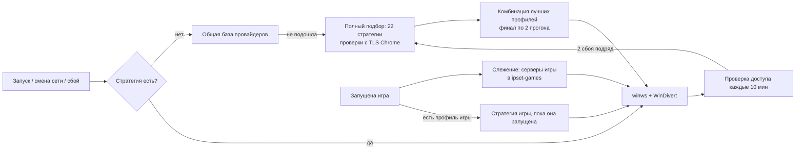

# Как это устроено

## Почему zapret работает

Провайдеры блокируют сайты с помощью DPI — оборудования, которое читает начало каждого соединения
(например, имя сайта в TLS ClientHello) и обрывает или замедляет «запрещённые».
[zapret](https://github.com/bol-van/zapret) (программа `winws.exe` + драйвер WinDivert) изменяет
исходящие пакеты так, что DPI не может понять, куда идёт соединение, а сервер — понимает:
режет пакет на части, отправляет поддельные пакеты, которые DPI принимает за настоящие и т. п.

Если сайт заблокирован **по IP-адресу**, хитрости с пакетами не помогают — нужен VPN или прокси.

## Схема

## Стратегии

Набор параметров winws называется стратегией. В [Flowseal/zapret-discord-youtube](https://github.com/Flowseal/zapret-discord-youtube)
их 22 (`general*.bat`). Каждая стратегия — несколько **профилей**, разделённых `--new`: отдельно для
YouTube/Google, общих сайтов, голосового Discord, QUIC, игр и т. д.

ZapretAuto:

1. Разбирает `.bat`-файлы в профили и группирует их по назначению (`tcp:443:list-google`,
   `udp:19294-19344:discord,stun`, …).
2. Для каждой стратегии запускает winws и проверяет набор целей: Discord, YouTube (включая скачивание
   ~1 МБ — DPI часто «замораживает» соединение после первых килобайт), Google, Cloudflare,
   голосовой Discord через STUN, YouTube и Discord по QUIC (HTTP/3 поверх UDP 443 — так их открывают браузеры).
   Все HTTPS-проверки идут с TLS-отпечатком Chrome: DPI и стратегии реагируют именно на него.
3. Для каждой группы выбирает стратегию, которая справилась с ней лучше, и **собирает комбинацию**
   из лучших профилей. Профиль заменяется только при реальном выигрыше (одиночные замеры шумные).
4. Перепроверяет финалистов несколько раз и выбирает победителя.

## Что ещё добавляется к стратегии

- `ipset-games.txt` — адреса серверов найденных игр (ко всем ipset-профилям);
- `ipset-telegram.txt` — подсети Telegram (если включено);
- `ipset-exclude-vpn.txt` — адреса VPN-серверов: их winws не трогает никогда;
- `--hostlist-auto` — winws сам добавляет в `list-auto.txt` сайты, соединения с которыми обрываются.

## Слежение за играми

WinDivert в режиме FLOW (только наблюдение, без изменения трафика) сообщает о каждом новом
соединении с номером процесса. Если процесс похож на игру (папка Steam/Epic/… или активный UDP
с несколькими серверами), его внешние адреса попадают в `ipset-games.txt`, winws сам перечитывает этот файл — перезапуск не нужен (он происходит один раз, когда обход для игр включается впервые, и откладывается, пока игра входит в онлайн). Для TCP-серверов программа замеряет время соединения до и после — если стало
хуже, адрес убирается.

## Надёжность

- Проверка доступа каждые 10 минут и при смене сети; два сбоя подряд → новый подбор
  (не чаще раза в 6 часов, отложенный до закрытия игры).
- winws упал → перезапуск (до 3 раз за 10 минут).
- Выход из сна → перезапуск обхода.
- Обновления: zapret скачивается только с GitHub, архив проверяется; установщик ZapretAuto
  сверяется с SHA-256 из релиза. Прерванное обновление откатывается при следующем запуске.

## Код

Python 3.12, PySide6, psutil, PyInstaller, Inno Setup. Структура — в [CLAUDE.md](../CLAUDE.md),
тесты — `tests/`, сборка — `build.ps1`.
