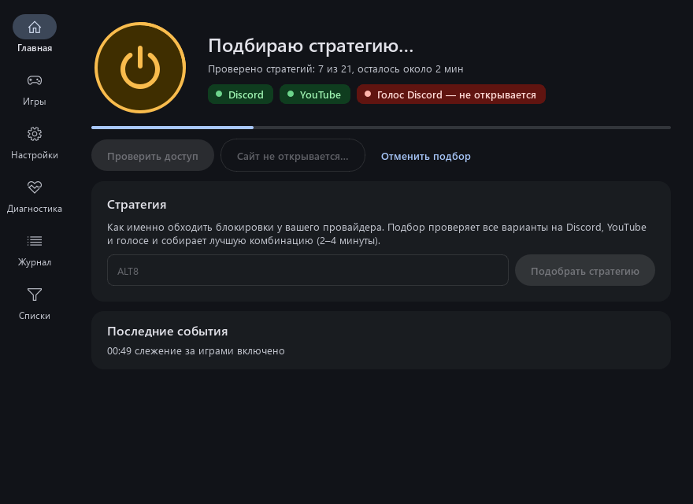
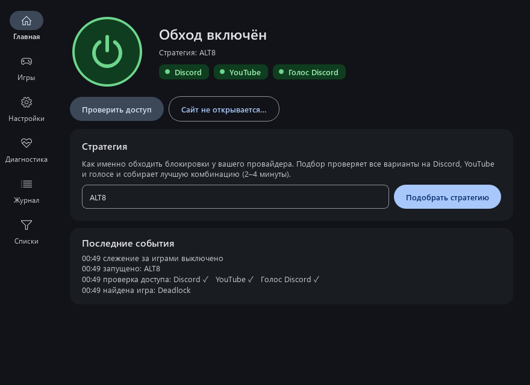

# Установка ZapretAuto — подробно

Время: 5–10 минут, из них 2–4 минуты программа настраивается сама.

## Что нужно

- Windows 10 или 11, 64-бит.
- Права администратора на компьютере (программа ставит сетевой драйвер WinDivert).
- Интернет без VPN на время первой настройки — или VPN в режиме раздельного туннелирования
  (подробнее в разделе [VPN](#если-у-вас-есть-vpn)).

## 1. Удалите другие программы обхода

ZapretAuto не уживается с другими программами того же типа — они перехватывают тот же трафик.
Перед установкой **закройте и удалите**:

- GoodbyeDPI, zapret / zapret-discord-youtube (в том числе установленный как служба `zapret`),
  «Discord fix», SD Bypass и подобные;
- если сомневаетесь — после установки программа сама покажет конфликты во разделе «Диагностика».

Если ставили zapret Flowseal как службу: запустите его `service.bat` → «Remove Services».

## 2. Скачайте установщик

1. Откройте страницу [последнего релиза](https://github.com/yuav2/ZapretAuto/releases/latest).
2. В разделе **Assets** скачайте `ZapretAuto-Setup.exe`.
   Файл `ZapretAuto-Setup.exe.sha256` скачивать не нужно — он для автообновления.

## 3. Запустите установщик

### «Windows защитила ваш компьютер» (SmartScreen)

Установщик пока не подписан сертификатом, поэтому Windows может показать синее окно.
Нажмите **«Подробнее»** → **«Выполнить в любом случае»**.

### Запрос прав администратора

Нажмите **«Да»** — без прав администратора обход работать не может.

### Шаги мастера

1. Язык — русский.
2. Папка установки — оставьте `C:\Program Files\ZapretAuto`.
3. Дополнительные задачи:
   - **Создать значок на рабочем столе** — по желанию;
   - **Добавить папку в исключения Защитника Windows** — рекомендуем включить, если у вас стоит только
     встроенный Защитник. Иначе он может удалить `winws.exe` (это ложное срабатывание,
     см. [Антивирусы](troubleshooting.md#антивирус-удалил-файлы-или-обход-не-запускается)).
4. «Установить» → «Завершить» с галочкой «Запустить ZapretAuto».

## 4. Первая настройка

При первом запуске появится окно **«Первая настройка»** → нажмите **«Да»**.

Что происходит в эти 2–4 минуты:

- программа определяет вашего провайдера и проверяет, нет ли для него готовой комбинации
  в [общей базе](guide.md#общая-база-провайдеров) — если есть и она работает, настройка займёт ~30 секунд;
- иначе по очереди пробует все стратегии (22 шт.) на Discord, YouTube и голосовом чате;
- собирает лучшую комбинацию и перепроверяет её.

Во время подбора Discord и YouTube могут ненадолго пропадать — это нормально.
Под шапкой видна полоса прогресса.

После подбора программа может предложить **поделиться результатом** — это поможет другим
пользователям вашего провайдера (отправляется только номер сети провайдера, без IP;
подробнее — [Приватность](privacy.md)). Можно отказаться.

## 5. Готово

- Большая кнопка зелёная — обход работает.
- Нажмите **«Проверить доступ»**: должны быть зелёные ✓ у Discord и YouTube.
- Закройте окно крестиком — программа уйдёт в **трей** (значок-щит возле часов) и продолжит работать.
  Выход — правый клик по значку → «Выход».

Рекомендуем включить:

- **«Запускать вместе с Windows»** — программа будет тихо стартовать в трей;
- **«Следить за играми»** — если играете в онлайн-игры.

## Если у вас есть VPN

- **VPN включён для всего трафика** — программа это заметит и будет проверять сеть мимо VPN.
  Но пока весь трафик идёт через VPN, zapret ему не нужен и ни на что не влияет.
- **Лучший вариант** — раздельное туннелирование: через VPN только то, что заблокировано по IP
  (например, Telegram), всё остальное — напрямую. Тогда Discord/YouTube работают через ZapretAuto.
- Серверы VPN автоматически исключаются из обхода, поэтому ZapretAuto не ломает VPN-туннель.

## Обновление

Ничего делать не нужно: при запуске программа сама проверяет новые версии ZapretAuto и zapret
и устанавливает их (установщик проверяется по контрольной сумме SHA-256).
Отключить — снять галочку «Автообновление».

Вручную: «Настройки» → «Проверить обновления», или просто скачайте и запустите новый
`ZapretAuto-Setup.exe` поверх старого — настройки сохранятся.

## Удаление

«Параметры Windows» → «Приложения» → ZapretAuto → «Удалить».
Удаление останавливает обход, убирает задачу автозапуска, драйвер WinDivert и исключение Защитника
(если вы его добавляли).
